<div align="center">


<h1>Arrow Browser</h1>

<p><b>A tiny, fast, privacy-first web browser for Linux.</b></p>

[](https://github.com/Sangam1112/Arrow-Browser/releases/latest)
[](LICENSE)
[](#-install)
[](#-small-by-design)
[-ee6a3a.svg)](#-updates)

[**Highlights**](#-highlights) · [**Screenshots**](#-screenshots) · [**Benchmarks**](#-benchmarks) · [**Limitations**](#known-limitations) · [**Install**](#-install) · [**Privacy**](#-privacy)

<br>

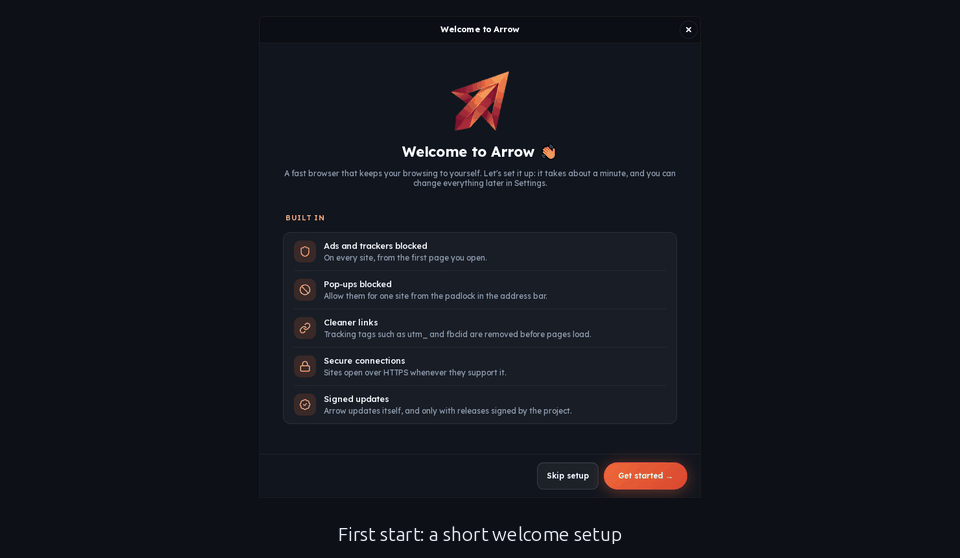

</div>

---

## 🌟 Why Arrow?

<table>
  <tr>
    <td width="25%" valign="top"><h3>🪶 Tiny</h3>A ~300 KB installer.</td>
    <td width="25%" valign="top"><h3>🛡️ Private</h3>Blocks trackers and ads from the first launch. No telemetry.</td>
    <td width="25%" valign="top"><h3>⚡ Light</h3>Sleeps unused tabs to stay quick on older PCs.</td>
    <td width="25%" valign="top"><h3>🔐 Safe</h3>Every page sandboxed, signed updates, passwords in your keyring.</td>
  </tr>
</table>

---

## ✨ Highlights

**🛡️ Privacy**
- **Ad and tracker blocking** with weekly EasyList/EasyPrivacy updates. Sign-in pages and captchas keep working.
- **No empty ad boxes or cookie banners:** the spaces ads leave and "Accept cookies" pop-ups are hidden (EasyList Cookie List). Nothing is accepted for you.
- **Clean links:** strips `utm_*`, `fbclid` and other tracking tags, and skips tracking redirects.
- **HTTPS only:** if a site has no secure version, you decide whether to continue.
- **Pop-up blocker:** ad pop-ups never open, and other sites' pop-ups wait for your OK. Allow them for a site with one click, or under the 🔒 padlock.
- **Per-site controls** under the 🔒 padlock: what was blocked on the page, ads, JavaScript, pop-ups, zoom and permissions, and clearing one site's cookies.
- **Fingerprint protection:** third-party cookies blocked, WebRTC off, graphics details hidden, canvas and audio fingerprints disguised per site.
- **Passwords in your system keyring** (GNOME Keyring, KWallet, KeePassXC), filled only when you click.
- **Privacy report** showing what was blocked.

**🔐 Security**
- **Every page runs in a sandbox**, so a hacked page can't reach your files.
- **No way past a bad certificate**, and a green padlock only for a verified one.
- **Files that can run programs** (`.sh`, `.AppImage`, `.deb`, `.exe`, …) **ask before downloading**.

**🧭 Extras**
- **Search shortcuts:** `w taj mahal` searches Wikipedia, `yt lofi` YouTube; add your own.
- **Import** bookmarks and history from Firefox, Chrome, Brave, Edge, Vivaldi, Opera and more, and passwords from a `.csv` export.
- **Dark mode for websites** that leaves already-dark sites alone.
- **Tab Memory:** see which tab uses the most memory and suspend or close it.
- **Search in Settings:** type in the box above the page list to find any option on any page.
- **Same look everywhere:** the Lexend font and line icons ship with Arrow, with an orange accent to match the logo.
- **Digital Wellbeing** (off by default): screen time per site, daily limits, break reminders and a greyscale bedtime mode. All of it stays on your computer.

---

## 📸 Screenshots

<table>
  <tr>
    <td align="center" valign="top"><b>Browsing</b><br>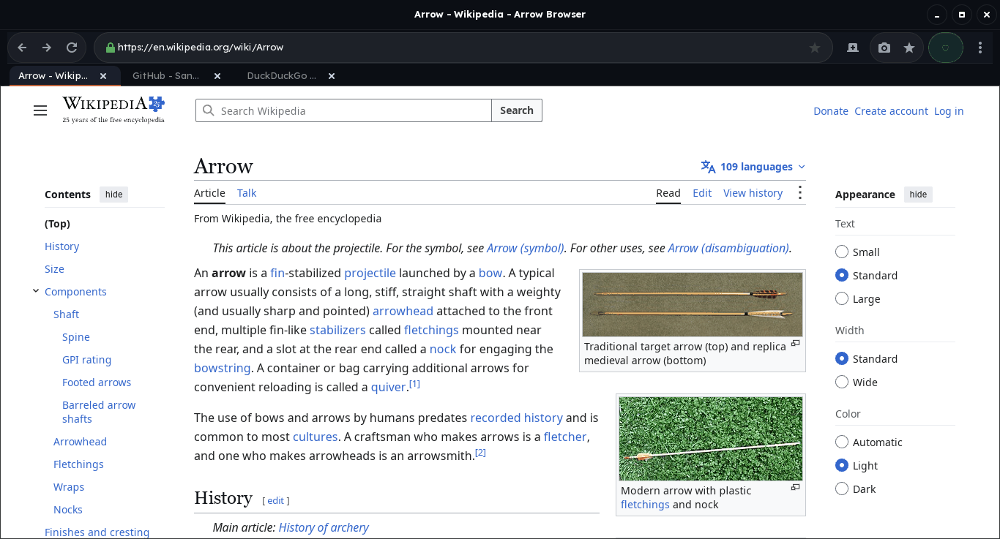</td>
    <td align="center" valign="top"><b>Padlock: certificate &amp; per-site controls</b><br>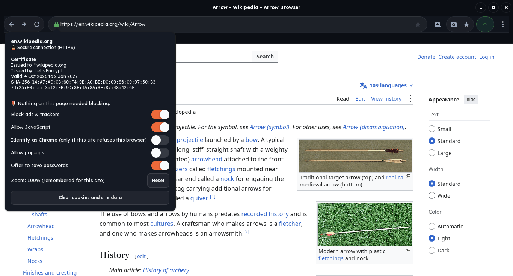</td>
  </tr>
  <tr>
    <td align="center" valign="top"><b>Main menu</b><br>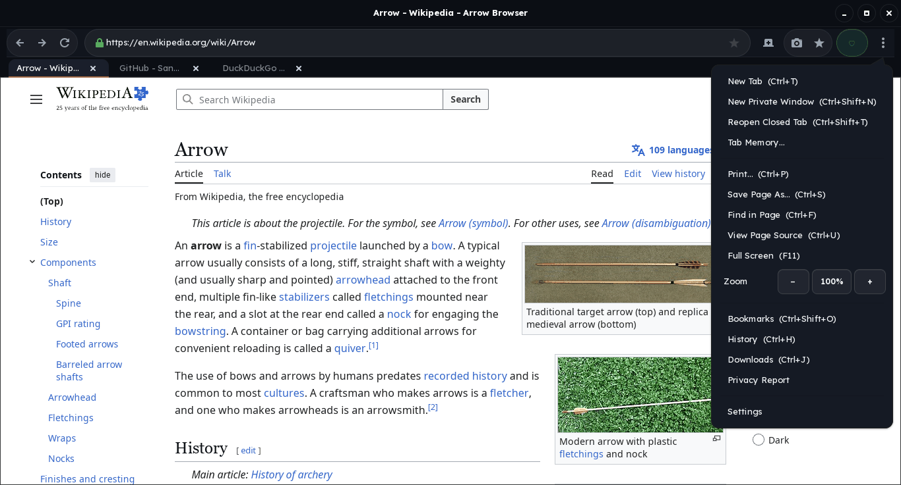</td>
    <td align="center" valign="top"><b>Tab Memory</b><br>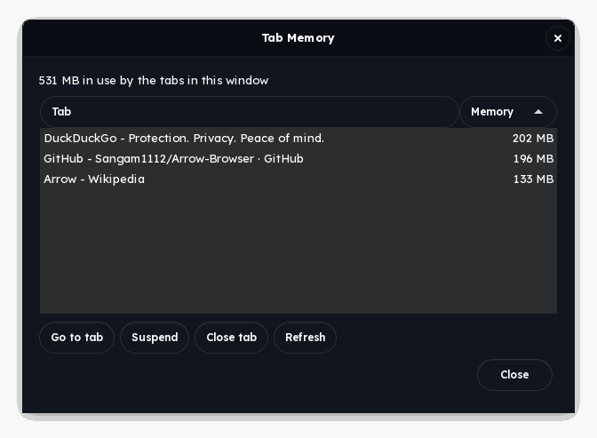</td>
  </tr>
</table>

<details>
<summary><b>⚙️ Settings pages</b></summary>

<table>
  <tr>
    <td align="center" valign="top"><b>General</b><br>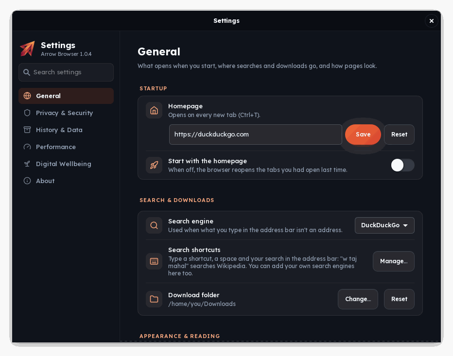</td>
    <td align="center" valign="top"><b>General (continued)</b><br>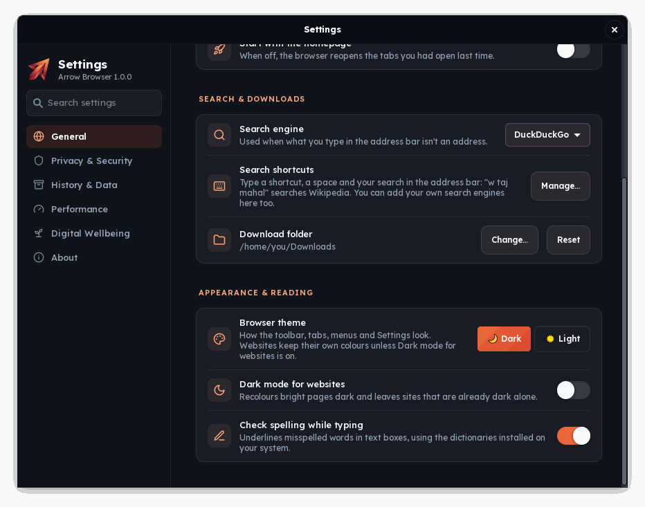</td>
  </tr>
  <tr>
    <td align="center" valign="top"><b>Privacy &amp; Security</b><br>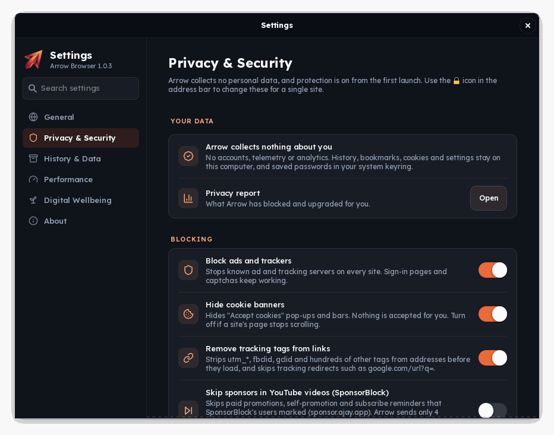</td>
    <td align="center" valign="top"><b>Privacy &amp; Security (continued)</b><br>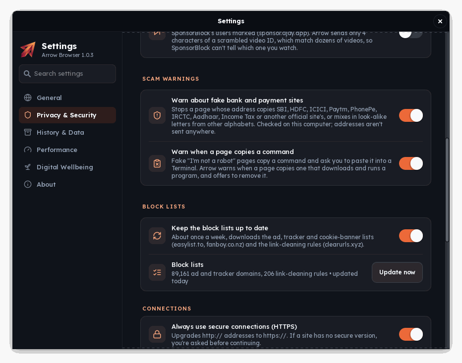</td>
  </tr>
  <tr>
    <td align="center" valign="top"><b>History &amp; Data</b><br>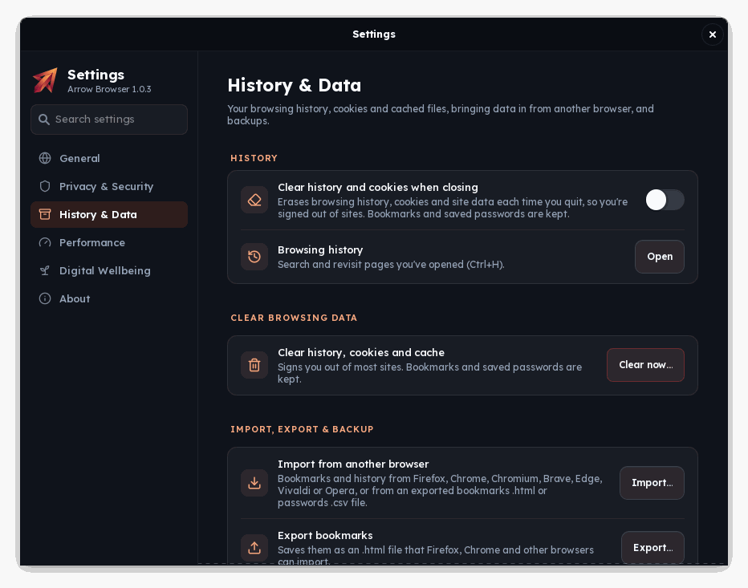</td>
    <td align="center" valign="top"><b>Performance</b><br>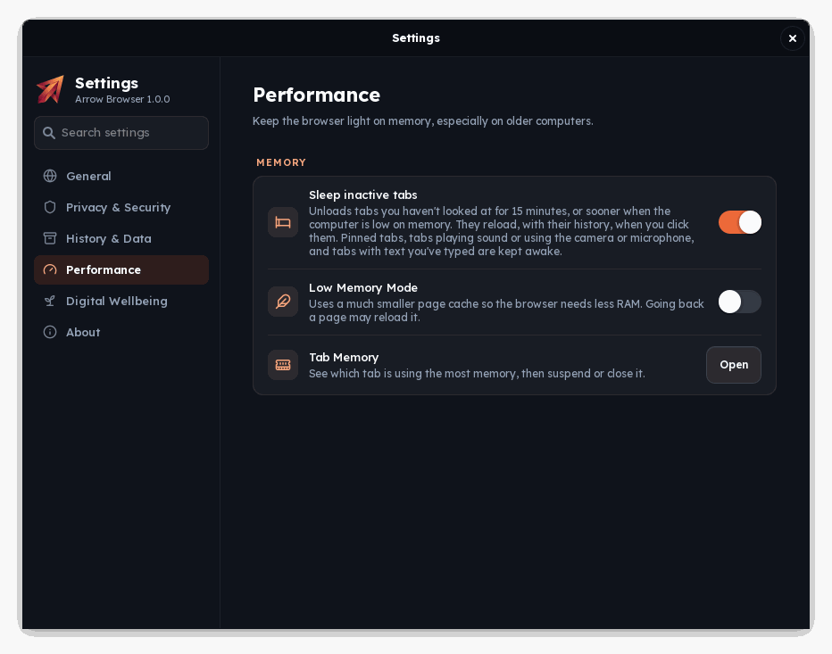</td>
  </tr>
  <tr>
    <td align="center" valign="top"><b>Digital Wellbeing</b><br>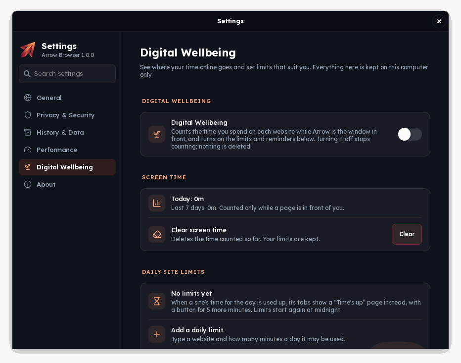</td>
    <td align="center" valign="top"><b>Digital Wellbeing (continued)</b><br>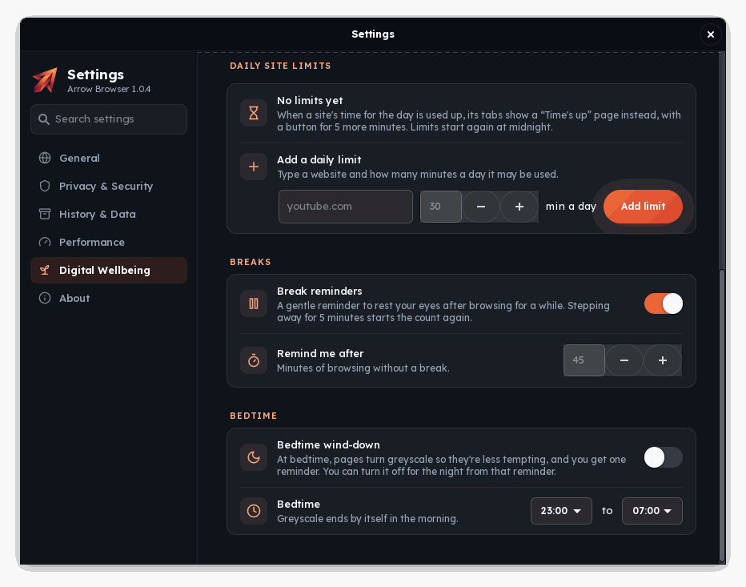</td>
  </tr>
  <tr>
    <td align="center" valign="top"><b>About</b><br>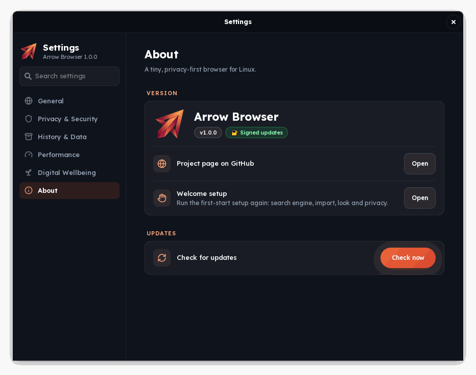</td>
  </tr>
</table>
</details>

---

## 📊 Benchmarks

Arrow (1.6.0, before the version reset) against Firefox 157, Brave 1.96 and Ungoogled Chromium 150 on a low-power laptop (AMD E2-7110, 6.7 GB RAM), October 2026. **Bold** is best.

| Test | Arrow | Firefox | Brave | Ungoogled Chromium |
| :--- | :---: | :---: | :---: | :---: |
| **Speedometer 3.1** (higher is better) | 1.57 | 1.83 | **3.27** | 2.27 |
| **Startup time** | 2.91 s | 8.11 s | **2.32 s** | 2.65 s |
| **Memory, one simple page** | **234 MB** | 642 MB | 385 MB | 405 MB |
| **Memory, one heavy page** | 485 MB | 717 MB | **458 MB** | 483 MB |
| **Memory, 6 tabs** | 688 MB | 764 MB | **498 MB** | 520 MB |
| **Engine tests** (% of the fastest) | 66% | 61% | **85%** | 69% |
| **Web features supported** (of 38) | 25 | 34 | **35** | **35** |

Arrow is the lightest with one page open and starts almost 3× faster than Firefox. It is the slowest in heavy web apps, and its memory grows faster than Brave's or Chromium's with many tabs open.

<details>
<summary><b>How it was measured</b></summary>

- Each browser ran alone from a fresh profile, with test pages served locally.
- Arrow ran with ad blocking on and WebRTC off; the others used their defaults (Brave's ad blocker on).
- Speedometer is the average of 10 iterations, repeated in a second run within 3%. Startup is the median of 5 launches. Memory is the PSS total of all the browser's processes.
- The machine is slow, so the ranking matters more than the absolute numbers.
</details>

---

<a id="known-limitations"></a>
## ⚠️ Known limitations

- **Security fixes for the web engine come with your Linux system updates**, sometimes weeks late. Keep your system up to date.
- **No DRM:** Netflix, Spotify, Prime Video, Disney+ and similar sites won't play.
- **Some sites may not work fully.** Try 🔒 padlock → **Identify as Chrome**. No passkeys, picture-in-picture, AV1 video or AVIF images yet.
- **No extensions** and **no sync**. To move to another computer, use Settings → History & Data → **Back up**.
- **Slower in heavy web apps** than Chromium-based browsers.
- **Known bug:** rarely, a tab showing an Arrow page (such as an error page) freezes if you go fullscreen while another tab of the same site opens a popup. Close the tab and reopen the page.

---

## 📦 Install

Get the package from the [**Releases page**](https://github.com/Sangam1112/Arrow-Browser/releases/latest), or run:

<table>
<tr><th>Ubuntu / Debian / Mint</th><th>Fedora / RHEL family</th></tr>
<tr valign="top"><td>

```bash
VERSION=1.0.0
wget https://github.com/Sangam1112/Arrow-Browser/releases/download/v$VERSION/arrow-browser_${VERSION}-1_all.deb
sudo apt install ./arrow-browser_${VERSION}-1_all.deb
```

</td><td>

```bash
VERSION=1.0.0
wget https://github.com/Sangam1112/Arrow-Browser/releases/download/v$VERSION/arrow-browser-${VERSION}-1.noarch.rpm
sudo dnf install ./arrow-browser-${VERSION}-1.noarch.rpm
```

</td></tr>
</table>

Use `apt install`, not `dpkg -i`, so dependencies install too. Then start Arrow from your app menu or run `arrow-browser`. For saved passwords you need a keyring (GNOME Keyring, KWallet or KeePassXC).

> RHEL, Rocky Linux, AlmaLinux and CentOS Stream should work but haven't been tried on a real machine yet. Please [tell us](https://github.com/Sangam1112/Arrow-Browser/issues) how it goes.

### From source (no root needed)

```bash
git clone https://github.com/Sangam1112/Arrow-Browser.git
cd Arrow-Browser
./install-ubuntu.sh        # Ubuntu / Debian / Mint
./install-fedora.sh        # Fedora and the RHEL family
```

This installs to `~/.local`; add `--system` to install for all users. If `arrow-browser` isn't found, add `export PATH="$HOME/.local/bin:$PATH"` to `~/.bashrc`.

<details>
<summary><b>Fedora without git</b></summary>

```bash
VERSION=1.0.0
wget https://github.com/Sangam1112/Arrow-Browser/releases/download/v$VERSION/arrow-browser_${VERSION}_fedora.tar.gz
mkdir -p /tmp/arrow_fedora
tar -xzf arrow-browser_${VERSION}_fedora.tar.gz -C /tmp/arrow_fedora
cd /tmp/arrow_fedora && ./install-fedora.sh
```
</details>

### 🔄 Updates

Arrow checks for updates shortly after it starts, or use **Settings → About → Check for updates**, then click **Restart now**. An update that isn't signed with the project key is never installed.

**Had Arrow before 1.0.0?** Copies from the old repository (1.6.9 and earlier) won't find this release, so install the 1.0.0 package once. Your bookmarks, history, passwords and settings stay, and Arrow updates itself from then on.

What changed: [CHANGELOG.md](CHANGELOG.md); notes from before 1.0.0 are in [docs/HISTORY.md](docs/HISTORY.md).

### 🗑️ Uninstall

```bash
sudo apt remove arrow-browser          # .deb
sudo dnf remove arrow-browser          # .rpm

# user install or self-updated copy
rm -rf ~/.local/share/arrow-browser ~/.local/bin/arrow-browser \
       ~/.local/share/applications/arrow-browser.desktop \
       ~/.local/share/icons/hicolor/256x256/apps/arrow-browser.png

# your data and cache
rm -rf ~/.config/arrow-browser ~/.cache/arrow-browser
```

Saved passwords live in your system keyring: delete them first in **Settings → Privacy & Security → Saved passwords**.

---

## 🧭 Keyboard shortcuts

The usual browser shortcuts work (`Ctrl+T`, `Ctrl+W`, `Ctrl+Shift+T`, `Ctrl+L`, `Ctrl+F`, `F3`, `Ctrl+D`, `Ctrl+P`, `Ctrl+S`, `Ctrl+U`, `Ctrl+1`…`Ctrl+9`, `Ctrl+PgUp`/`PgDn`, `F11`, `Alt+Home`, zoom with `Ctrl++`/`Ctrl+-`/`Ctrl+0`). Also: `Ctrl+H` history, `Ctrl+J` downloads, `Ctrl+Shift+O` bookmarks, `Ctrl+Shift+N` private window, `Ctrl+Shift+Del` clear browsing data.

Developer tools (`F12`) are off by default: set `"dev_tools_enabled": true` in `~/.config/arrow-browser/settings.json` and restart.

---

## 🔒 Privacy

No telemetry, analytics or accounts. Apart from the sites you visit, Arrow connects only to:

| What | To | When | Turn off |
|---|---|---|---|
| Update check | `api.github.com`, `raw.githubusercontent.com` | At startup and when you click *Check for updates* | n/a |
| Ad and tracker lists | `easylist.to` | About once a week | Settings → Privacy & Security → *Keep the block lists up to date* |
| Link-cleaning rules | `rules2.clearurls.xyz` (fallback `gitlab.com`) | About once a week | Same switch |
| Link prefetch | links you hover over | While browsing (not in private windows) | n/a |

Your data stays in `~/.config/arrow-browser` and `~/.cache/arrow-browser`, and passwords in your keyring. Private windows save nothing.

Found a security problem? Open a [GitHub issue](https://github.com/Sangam1112/Arrow-Browser/issues), or contact the maintainer privately if it's sensitive.

---

## 🪶 Small by design

| Browser | Installer | Installed |
|---|---|---|
| **Arrow Browser** | **~290–380 KB** | **~0.9 MB** |
| Google Chrome | ~90–100 MB | ~250–350 MB |
| Mozilla Firefox | ~55–75 MB | ~200–300 MB |
| Chromium | ~100–150 MB | ~300–400 MB |
| Brave | ~90–110 MB | ~300+ MB |
| Microsoft Edge | ~90–100 MB | ~250–350 MB |

Other browsers each ship their own web engine. Arrow uses the one your Linux desktop already has, so it is 150–500× smaller.

> Arrow's sizes are from the 1.0.0 packages (.rpm and .deb), including its font and icons; the others are typical public figures.

---

## 📄 License

© 2026 Sangam1112. Free software under the [GNU General Public License v3.0 or later](LICENSE). Releases up to 1.5.19 in the earlier repository were under the MIT License.

Bundled: the Lexend font (SIL Open Font License, [`assets/fonts/OFL.txt`](assets/fonts/OFL.txt)) and Lucide icons (ISC, [`assets/icons/LICENSE`](assets/icons/LICENSE)).
